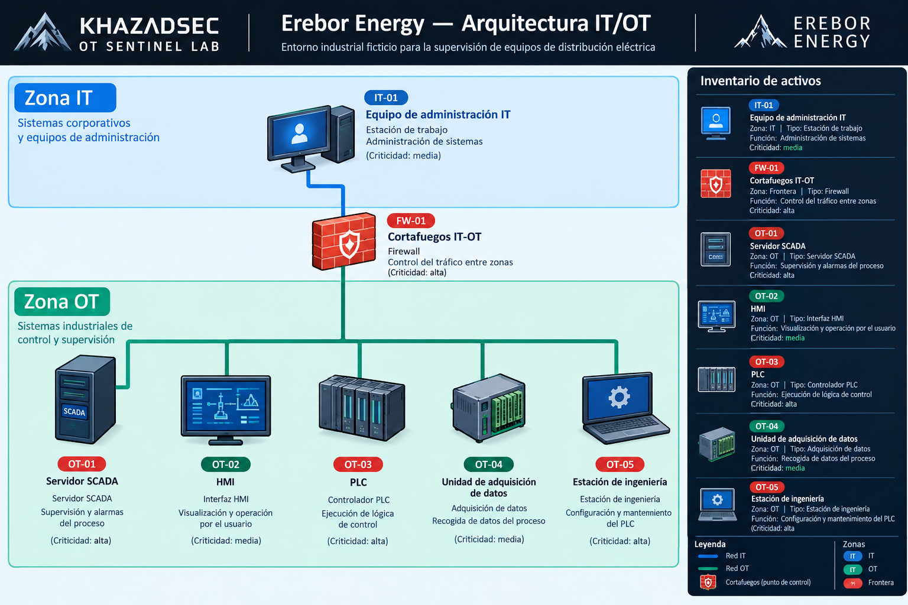

# KhazadSec OT Sentinel

Laboratorio didáctico de análisis de riesgos en un entorno IT/OT ficticio, desarrollado con Python y reglas de detección explícitas.

## Objetivo

Modelar un pequeño entorno industrial, inventariar sus activos y comunicaciones, e identificar condiciones de riesgo mediante un analizador reproducible.

El proyecto busca demostrar conceptos de seguridad OT, validación de datos, detección basada en reglas y generación de informes estructurados.

## Escenario

Erebor Energy es una instalación industrial ficticia creada exclusivamente para este laboratorio. Los activos, las comunicaciones y sus propiedades son datos de ejemplo, no resultados de una auditoría real.

### Diagrama de activos y comunicaciones



El diagrama representa el modelo lógico del escenario. No constituye una topología verificada ni demuestra que las comunicaciones o los controles descritos estén implementados en una instalación real.

## Reglas de detección

El analizador implementa cuatro reglas:

| Regla | Condición detectada | Prioridad propuesta |
|---|---|---|
| R-01 | Comunicación marcada como no autorizada | Alta |
| R-02 | Activo de la zona OT sin acceso restringido | Alta |
| R-03 | Política de actualizaciones no definida | Media |
| R-04 | Comunicación condicional sin control previsto documentado | Media |

Las prioridades son orientativas y corresponden al catálogo de reglas del laboratorio; no sustituyen una evaluación de riesgos contextualizada.

## Requisitos

- Python 3.
- No se requieren bibliotecas externas.

## Ejecución

Desde la raíz del repositorio, ejecuta:

```powershell
python src/analyzer.py
```

El analizador carga los archivos CSV de `data/`, valida los datos, ejecuta las reglas y genera el informe:

```text
reports/hallazgos.csv
```

El informe contiene identificadores de hallazgo, regla activada, elemento afectado, prioridad, evidencia de entrada y recomendación.

## Pruebas automatizadas

El proyecto incluye pruebas automatizadas con unittest, el framework de pruebas integrado en Python. No es necesario instalar dependencias adicionales.

Para ejecutar las pruebas desde la raíz del repositorio:

```powershell
python -m unittest discover -s tests -v
```
La suite contiene 12 pruebas que verifican:

- La detección de las cuatro reglas (R-01 a R-04).
- El comportamiento de R-04 cuando existe un control documentado.
- La validación de los datos de entrada, incluidos valores inválidos, campos obligatorios y referencias a activos inexistentes.
- La gestión de errores de validación sin sobrescribir el informe existente.
- El resultado esperado del escenario de ejemplo.

Con los datos ficticios actuales, el analizador genera cinco hallazgos: uno de R-01, uno de R-02 y tres de R-03. R-04 no genera hallazgos porque la comunicación condicional del escenario tiene un control documentado.

Los resultados son comprobaciones basadas en las reglas definidas y en los datos de ejemplo; no constituyen evidencia de incidentes reales ni una auditoría de una instalación industrial.

## Resultado esperado

Con los datos de ejemplo incluidos en el repositorio, la ejecución genera cinco hallazgos:

- 1 hallazgo R-01: comunicación no autorizada en el modelo.
- 1 hallazgo R-02: activo OT sin acceso restringido documentado.
- 3 hallazgos R-03: política de actualizaciones no definida.
- 0 hallazgos R-04: no hay comunicaciones que cumplan actualmente esa condición.

El analizador también valida referencias entre comunicaciones e inventario. Si encuentra referencias a activos inexistentes, detiene el análisis y muestra un error de validación.

## Estructura del proyecto

```text
data/       Inventario y comunicaciones de ejemplo en CSV
docs/       Escenario, reglas de detección y formato de hallazgos
img/        Banner y diagrama del escenario
src/        Analizador Python
reports/    Informes generados durante la ejecución
```

## Limitaciones

- Todos los datos son ficticios y se utilizan con fines didácticos.
- El analizador trabaja con archivos CSV; no captura ni inspecciona tráfico de red.
- No se conecta a PLC, HMI, servidores SCADA ni otros sistemas industriales.
- Una comunicación marcada como no autorizada representa una condición definida en el modelo, no evidencia de tráfico real.
- Una política de actualizaciones no definida no demuestra que un activo esté desactualizado.
- Los hallazgos dependen de los datos de entrada y de las reglas implementadas; no equivalen a una auditoría completa ni certifican la seguridad de una instalación.

## Estado del proyecto

Versión inicial funcional: inventario de ejemplo, catálogo de cuatro reglas, validación de datos y generación de informes CSV.

